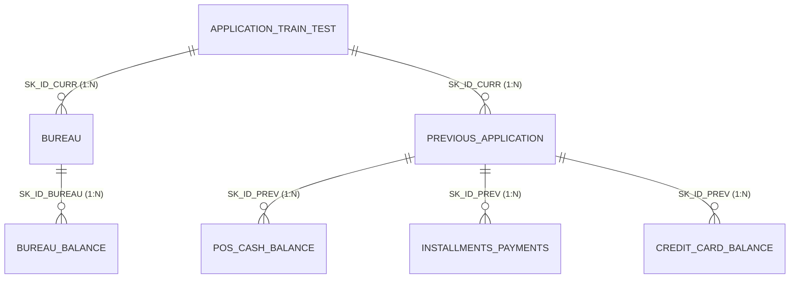
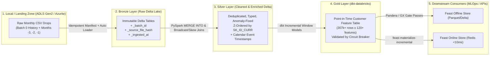

# Home Credit — Senior Data Engineering Lakehouse: Complete Step-by-Step Guide

## 1. Executive Summary & What We Are Building

This project transforms the static **Home Credit Default Risk** dataset (~50+ million rows across 7 relational tables, ~2.6 GB on disk) into an enterprise-grade, fault-tolerant **Banking Data Lakehouse & Feature Store** built with **Azure, Databricks, PySpark, Delta Lake, dbt, Docker, Great Expectations/Pandera, Feast, Redis, and GitHub Actions CI/CD**.

Instead of treating the dataset as a one-off Kaggle notebook, we engineer it the way a Tier-1 bank or FinTech processes core banking and credit bureau data:
1. **Temporal Split & Monthly Batch Simulation (The Source Simulator):**
   - **Initial Historical Upload (`batch_0_history`):** All historical records up to 3 months prior to application (`MONTHS_BALANCE <= -4` / `DAYS <= -91`, anchored to calendar dates through **Sep 2025**).
   - **Monthly Incremental Drops (`batch_1` to `batch_3`):** Three monthly incremental batches (**Oct 2025, Nov 2025, Dec 2025** corresponding to `MONTHS_BALANCE` `-3`, `-2`, and `-1/0`) to test automated ingestion, schema evolution, late-arriving records, and mid-upload failure recovery.
2. **Medallion Lakehouse Architecture (`Bronze -> Silver -> Gold`):**
   - **Bronze:** Raw immutable Delta tables with cryptographic file hashes, ingestion audit metadata, and schema enforcement.
   - **Silver:** Cleaned, deduplicated, anomaly-remediated relational tables physically optimized with `OPTIMIZE` and `ZORDER BY (SK_ID_CURR)`.
   - **Gold (`dbt-databricks`):** Point-in-Time (zero data-leakage) customer feature spine (~307k loans × 120+ engineered behavioral credit features across 30/90/180-day windows).
3. **Data Quality Circuit Breakers:** Automated validation gates that halt publication to Gold/Feature Store if schema contracts, null thresholds, or financial domain invariants fail.
4. **Dual Feature Store (Feast + Parquet/Delta + Redis):**
   - **Offline Store:** Time-travel-capable Gold Delta/Parquet tables for downstream MLOps training (Out-Of-Time splits).
   - **Online Store:** Low-latency (`<10ms`) Redis key-value store serving the latest feature vector per `SK_ID_CURR` for real-time credit scoring APIs.

---

## 2. The 7 Home Credit Relational Tables & Data Challenges



| Table | Approximate Rows | Grain / Primary Key | Time Column(s) | Key Senior DE Challenge |
| :--- | :--- | :--- | :--- | :--- |
| `application_train.csv` & `application_test.csv` | 356,255 | `SK_ID_CURR` (Loan application) | `DAYS_BIRTH`, `DAYS_EMPLOYED`, `DAYS_ID_PUBLISH` | Legacy sentinel value `DAYS_EMPLOYED = 365243` (1,000 years) representing pensioners/unemployed; must become `NULL` + boolean flag `IS_DAYS_EMPLOYED_ANOMALY`. |
| `bureau.csv` | 1,716,428 | `SK_ID_BUREAU` (External credit) | `DAYS_CREDIT`, `DAYS_CREDIT_UPDATE`, `DAYS_ENDDATE_FACT` | 1-to-many with `SK_ID_CURR`; contains active and closed external credits with overdue amounts. |
| `bureau_balance.csv` | 27,299,925 | `(SK_ID_BUREAU, MONTHS_BALANCE)` | `MONTHS_BALANCE` (`-96` to `0`) | **Largest table (27.3M rows)**; does **not** have `SK_ID_CURR` directly—requires a distributed join through `bureau.csv` (handling data skew). |
| `previous_application.csv` | 1,670,214 | `SK_ID_PREV` (Past internal loan) | `DAYS_DECISION`, `DAYS_TERMINATION` | Multiple sentinel values (`365243` in `DAYS_FIRST_DRAWING`, `DAYS_LAST_DUE`). |
| `POS_CASH_balance.csv` | 10,001,358 | `(SK_ID_PREV, MONTHS_BALANCE)` | `MONTHS_BALANCE` (`-96` to `-1`) | Monthly snapshots of point-of-sale & cash loans; requires windowed delinquency aggregations. |
| `installments_payments.csv` | 13,605,401 | `(SK_ID_PREV, NUM_INSTALMENT_NUMBER, NUM_INSTALMENT_VERSION)` | `DAYS_INSTALMENT`, `DAYS_ENTRY_PAYMENT` | Split payments (multiple rows for the same installment number) & restructured schedules (`NUM_INSTALMENT_VERSION` changes). |
| `credit_card_balance.csv` | 3,840,312 | `(SK_ID_PREV, MONTHS_BALANCE)` | `MONTHS_BALANCE` (`-96` to `-1`) | Revolving utilization ratios (`AMT_BALANCE / AMT_CREDIT_LIMIT_ACTUAL`), minimum payment ratios, and ATM drawing spikes. |

---

## 3. Why Medallion Architecture (`Bronze -> Silver -> Gold`) is the Industry Standard



1. **Bronze (Raw Immutable + Auditability):**
   - **What it does:** Stores an exact, append-only history of every file that arrived, converted from slow CSVs into compressed **Delta Lake (Parquet + `_delta_log`)**, enriched with `_ingestion_timestamp`, `_source_file`, `_file_sha256`, and `_batch_id`.
   - **Why it is critical:** If a developer introduces a bug in a Silver transformation 3 months from now, you **never** need to re-request or re-upload data from the source banking system. You can replay Silver directly from Bronze using Delta Time Travel (`TIMESTAMP AS OF` / `VERSION AS OF`).
2. **Silver (Single Source of Truth / Enterprise Conformed Layer):**
   - **What it does:** Enforces strict data types, deduplicates re-transmitted rows, replaces legacy sentinel codes (`365243` -> `NULL`), resolves entity keys (joining `SK_ID_CURR` onto `bureau_balance`), and runs `OPTIMIZE ... ZORDER BY (SK_ID_CURR)` so downstream queries skip 90%+ of irrelevant data blocks.
   - **Why it is critical:** Separates **data hygiene** from **business logic**. Data analysts, data scientists, and compliance auditors can query Silver knowing duplicates and corrupt records are gone.
3. **Gold (Business & ML Feature Layer via `dbt`):**
   - **What it does:** Aggregates 50M+ transactional rows into domain-specific marts and our **Master Point-in-Time Credit Risk Feature Table** (e.g., 30-day vs. 180-day payment velocity, max Days Past Due, credit card utilization trends).
   - **Why it is critical:** Keeps complex feature engineering modular, version-controlled, tested, and documented in `dbt` with full column-level lineage.

---

## 4. Deep Dive: Surviving Interrupted Uploads & Preventing Duplicates (Idempotency)

One of the most important differences between a junior script and a **Senior Data Engineering pipeline** is **Idempotency**: running the exact same pipeline $N$ times (or restarting after a crash at 67%) produces the **exact same result as running it once**, with **zero duplicate rows**.

Here are the **4 defense layers** we will build to handle interrupted uploads and job retries:

### Defense 1: Multi-Part Block Upload + SHA-256 Manifest at the Storage Boundary (Local -> Azure ADLS Gen2 / Azurite)
- **The Problem:** You are uploading `installments_payments_batch_0.csv` (650 MB). At 70%, your Wi-Fi drops or the process crashes.
  - A naive script either leaves a half-written corrupt file in the cloud (which Spark immediately ingests, corrupting Bronze) or re-uploads records that were already ingested.
- **The Senior Solution:**
  1. **Azure Blob Staging (`put_block` / `put_block_list`):** The Azure SDK uploads large files in small blocks (e.g., 4 MB chunks). None of those blocks are visible to readers until the final `Commit Block List` call succeeds atomically. If the upload dies at 99%, the file does not exist in the landing zone yet.
  2. **`_SUCCESS` Marker & Manifest Contract:** Our uploader writes a `manifest.json` containing each file's `sha256` checksum and row count, and writes a `_SUCCESS` marker last. Before uploading any file on retry, the uploader checks if the remote blob already exists with a matching `Content-MD5` / `sha256` metadata tag—skipping already-completed files automatically.

### Defense 2: Checkpoint State & File-Hash Ledger in Bronze Ingestion
- **The Problem:** Suppose the file finished uploading, and the Databricks job ingested 3 out of 7 tables into Bronze before the Spark cluster crashed. When you click "Retry Job", you don't want those first 3 tables ingested a second time.
- **The Senior Solution:**
  - **Databricks Auto Loader (`cloudFiles`)** or our **Bronze Ingestion Ledger Table (`_meta.ingestion_ledger`)**:
    - Before processing a file, Spark checks if `(table_name, batch_id, file_sha256)` is already marked `COMMITTED` in `_meta.ingestion_ledger`.
    - Furthermore, writes to Bronze use Delta Lake's `txnAppId` and `txnVersion` options (or `replaceWhere = "_batch_id = 'batch_2025_11'"`). Delta Lake's `_delta_log` natively rejects duplicate `(txnAppId, txnVersion)` commits!

### Defense 3: ACID Transactions in Delta Lake (`_delta_log`)
- **The Problem:** What if Spark crashes *while* writing 27 million rows into `silver.bureau_balance` after writing 15 million rows to disk?
- **The Senior Solution:**
  - Unlike raw CSV or plain Parquet folders (where half-written `.parquet` files corrupt the table), **Delta Lake uses an atomic transaction log (`_delta_log/000001.json`)**.
  - Readers *only* read Parquet files listed in a committed JSON log entry. Uncommitted Parquet files from a crashed job are completely invisible to queries and are cleaned up automatically by `VACUUM`.

### Defense 4: Deterministic Composite Keys + `MERGE INTO` (Upsert) in Silver & Gold
- **The Problem:** What if the bank's source system itself sends an overlapping monthly file containing 10,000 rows from last month alongside 50,000 new rows, or updates an existing loan's status?
- **The Senior Solution:**
  - Every table in Silver has a deterministic **Primary / Surrogate Key** (`_row_hash = sha2(concat_ws('||', PK_cols), 256)`).
  - First, we deduplicate within the incoming batch using `Window.partitionBy(pk).orderBy(col("_ingestion_timestamp").desc())`.
  - Second, we write to Silver using Delta's atomic **`MERGE INTO`** (Upsert):
    ```sql
    MERGE INTO silver.pos_cash_balance AS target
    USING incoming_batch AS source
    ON target.SK_ID_PREV = source.SK_ID_PREV
       AND target.MONTHS_BALANCE = source.MONTHS_BALANCE
    WHEN MATCHED AND source._ingestion_timestamp >= target._ingestion_timestamp THEN
      UPDATE SET *
    WHEN NOT MATCHED THEN
      INSERT *
    ```
  - Even if you accidentally feed the exact same monthly CSV 10 times, `MERGE INTO` guarantees **zero duplicates**.

---

## 5. How Azure, Databricks, Docker, dbt, Feast & CI/CD Fit Together

Since you mentioned wanting to understand **what each tool actually does outside of notebooks**, here is the plain-English breakdown:

| Tool | What It Actually Is | Why We Use It Here |
| :--- | :--- | :--- |
| **Azure Data Lake Storage Gen2 (ADLS Gen2) / Azurite** | Cloud object storage built for big data (folders/containers of files). **Azurite** is Microsoft's official local Docker emulator that speaks the exact same Azure Python SDK. | Holds the raw incoming CSV batches (`landing` container) before Databricks ingests them. |
| **Databricks (beyond Notebooks)** | An enterprise data platform built around Apache Spark, Delta Lake, **Unity Catalog** (data governance/permissions), **SQL Warehouses**, and **Databricks Workflows (Jobs)**. | In production, we don't click "Run All" in notebooks. We package Python modules/scripts and schedule multi-task **Databricks Workflows (DAGs)** with automatic retries and alerts. |
| **dbt (`dbt-core` / `dbt-databricks`)** | "Data Build Tool" — transforms data inside your Lakehouse using modular SQL `SELECT` statements + Jinja templates, then automatically builds tables, runs schema/null/uniqueness tests, and generates a lineage website. | Powers our **Silver -> Gold** layer (120+ credit features), ensuring every feature is documented, tested, and incrementally updated. |
| **Docker & Docker Compose** | Packages services (databases, emulators, APIs) into isolated containers so they run identically on any machine with one command (`docker compose up -d`). | Runs our local **Azurite** (Azure Storage emulator), **Redis** (Online Feature Store), and deterministic test environment without polluting Windows. |
| **Pandera / Great Expectations** | Data validation frameworks ("unit tests for live data"). | Acts as a **Circuit Breaker**: before Gold updates the Feature Store, it verifies business rules (e.g., `AMT_CREDIT > 0`, no `365243` sentinel leakage, null ratios `< threshold`). |
| **Feast + Redis** | **Feast** is an open-source Feature Store that bridges **Offline storage** (Delta/Parquet for training ML models) and **Online storage** (**Redis** in-memory database for `<10ms` live inference). | Ensures your next MLOps project has **0% Training-Serving Skew** (the exact same feature definitions power both training and live API scoring). |
| **GitHub Actions (CI/CD)** | Automated pipelines triggered on every `git push` or Pull Request. | Automatically runs `ruff` (linter), `pytest` (unit & idempotency tests), and `dbt parse/compile` before code can be merged or deployed to Databricks. |

---

## 6. Cloud Strategy: 100% Free vs. Azure Pay-As-You-Go

You can start **100% Free** today and switch to (or combine with) **Azure Pay-As-You-Go** smoothly because our code uses environment configuration variables:

### Path A: Start 100% Free (Zero Credit Card Risk)
1. **Databricks Free Edition** (`login.databricks.com`): Gives you free Serverless Spark compute, Unity Catalog (`workspace` catalog + Managed Volumes), a free 2X-Small SQL Warehouse (which `dbt-databricks` connects to!), and Databricks Workflows/Jobs.
2. **Docker Desktop Locally:** Runs **Azurite** (emulating Azure Blob/ADLS Gen2 locally) and **Redis** (for Feast Online Store).
3. **How they connect:** Our Python ingestion script reads from local Azurite (using the real `azure-storage-blob` SDK) and uploads validated batches to **Databricks Unity Catalog Volumes** (`/Volumes/home_credit/landing/batches/`) via the official `databricks-sdk`.

### Path B: Real Azure Cloud (Azure Free $200 Credit or Pay-As-You-Go)
1. **Azure Resource Group (`rg-homecredit-de-dev`):** Logical container for all your Azure resources.
2. **Azure Storage Account (`sthomecreditdedev`) with Hierarchical Namespace enabled (ADLS Gen2):** Costs **~$0.02 per GB per month** (storing 3 GB of Home Credit data costs **~$0.06/month**!).
3. **Azure Databricks Workspace (Trial / Pay-As-You-Go):** Connected to ADLS Gen2 via an **Azure Managed Identity (`Access Connector for Azure Databricks`)** and a **Unity Catalog External Location** (`abfss://lakehouse@sthomecreditdedev.dfs.core.windows.net/`).

> [!TIP]
> **Best Learning Strategy:** We will build the project so that **Phase 0–4 works locally + on Databricks Free Edition** right out of the box, AND includes the exact **Azure CLI / Terraform scripts & step-by-step instructions** to provision the real Azure Storage Account (ADLS Gen2) so you experience both!

---

## 7. Target Repository Structure (Senior Engineering Standard)

Instead of loose notebooks, we structure the repository as an installable, tested Python + dbt project:

```text
home-credit-data-engineering/
├── .github/
│   └── workflows/
│       └── ci.yml                      # GitHub Actions: ruff, pytest, dbt compile
├── docker/
│   └── docker-compose.yml              # Azurite (Azure Storage Emulator) + Redis (Feast Online)
├── configs/
│   └── pipeline_config.yaml            # Batch dates, table primary keys, storage paths, quality thresholds
├── src/
│   └── home_credit_de/
│       ├── __init__.py
│       ├── contracts/                  # Pydantic v2 / PySpark StructType schemas for all 7 tables
│       ├── simulator/
│       │   └── split_batches.py        # Splits raw CSVs into Historical (<= -4m) + 3 Monthly Drops (-3, -2, -1)
│       ├── ingestion/
│       │   ├── azure_uploader.py       # Fault-tolerant chunked uploader with SHA-256 manifest & retry
│       │   └── bronze_loader.py        # Idempotent Landing -> Bronze Delta loader with ledger tracking
│       ├── transformation/
│       │   └── silver_processor.py     # Anomaly fixes (365243), deduplication, MERGE INTO, Z-Ordering
│       └── quality/
│           └── circuit_breaker.py      # Pandera / PySpark Data Quality Gate before Gold & Feast
├── dbt_home_credit/                    # dbt-databricks project (Silver -> Gold)
│   ├── dbt_project.yaml
│   ├── profiles.yml.example
│   └── models/
│       ├── staging/                    # Views over Silver Delta tables
│       ├── intermediate/               # Windowed aggregations (bureau, pos_cash, installments, cc)
│       └── marts/
│           └── gold_customer_features.sql  # 120+ Point-in-Time features per SK_ID_CURR
├── feature_store/                      # Feast configuration
│   ├── feature_store.yaml
│   └── features.py                     # Entity (sk_id_curr) & FeatureViews for Offline/Online sync
├── databricks.yml                      # Databricks Asset Bundle (DAB) defining automated Jobs/Workflows
├── tests/                              # Unit tests + Idempotency & Interrupted Upload chaos tests
├── pyproject.toml                      # Dependency management (uv / pip)
└── DATA_ENGINEERING_STEP_BY_STEP_GUIDE.md
```

---

## 8. The Step-by-Step Implementation Roadmap

We will build this together **phase by phase**. In each phase, I will explain the concepts, write/review the code with you, and help you run and verify it before moving to the next phase.

### Phase 0: Local Engineering Setup, Docker Infrastructure & Project Skeleton
- **What you'll learn:** Modern Python packaging (`pyproject.toml`), Docker Compose for Data Engineering, and Microsoft Azurite (local Azure Blob/ADLS emulator) + Redis.
- **What we'll do:**
  1. Create the clean folder structure and `pyproject.toml`.
  2. Spin up `docker-compose.yml` with **Azurite** (Azure Storage) and **Redis** (Online Feature Store).
  3. Verify connectivity from Python to Azurite and Redis.

### Phase 1: The Temporal Source Simulator & Fault-Tolerant Azure/Databricks Ingestion (Bronze)
- **What you'll learn:** How real banking batch drops work, Azure Blob/ADLS Gen2 SDK (`azure-storage-blob`), cryptographic file manifests (`SHA-256`), schema contracts, and Delta Lake Bronze tables.
- **What we'll do:**
  1. Build `split_batches.py` to anchor applications on a timeline and slice the 7 Home Credit CSVs into **4 sequential delivery batches**:
     - `batch_0_history` (all history up to 4 months prior, `<= 2025-09`)
     - `batch_1_2025_10` (Month `-3`)
     - `batch_2_2025_11` (Month `-2`)
     - `batch_3_2025_12` (Month `-1` / `0`)
  2. Build `azure_uploader.py` with chunked uploads, SHA-256 verification, and a **chaos flag (`--simulate-network-drop-at 50%`)** so you can watch an upload fail mid-flight and recover cleanly without re-uploading completed files.
  3. Set up your **Databricks Free Edition** (or Azure Databricks) workspace & Unity Catalog (`home_credit` catalog, `bronze`, `silver`, `gold` schemas) and run `bronze_loader.py` to load `batch_0_history` into partitioned Delta tables with `_batch_id`, `_file_sha256`, and `_ingestion_timestamp`.

### Phase 2: Distributed PySpark Cleaning, Deduplication & Physical Tuning (`Bronze -> Silver`)
- **What you'll learn:** PySpark physical execution plans, Broadcast Joins vs. Sort-Merge Joins, fixing legacy sentinel values, deterministic deduplication with Window functions, Delta Lake `MERGE INTO` (Upserts), and `OPTIMIZE ... ZORDER BY`.
- **What we'll do:**
  1. Clean all 7 tables in PySpark (e.g., converting `365243` in `DAYS_EMPLOYED` and `previous_application` date columns to `NULL` + indicator flags; casting strict numeric/date types).
  2. Resolve the 27.2M-row `bureau_balance` join with `bureau` to attach `SK_ID_CURR` efficiently.
  3. Implement idempotent `MERGE INTO` logic on every Silver table and test it by deliberately re-running `batch_1_2025_10` twice—proving row counts remain identical (`0` duplicates).
  4. Run `OPTIMIZE` and `ZORDER BY (SK_ID_CURR)` and measure query speedup.

### Phase 3: Point-in-Time Feature Engineering with `dbt-databricks` (`Silver -> Gold`)
- **What you'll learn:** How `dbt` works with Databricks SQL Warehouses, modular SQL modeling (`staging -> intermediate -> marts`), incremental materializations, Point-in-Time window aggregations, automated lineage graphs, and benchmark feature engineering pipelines.
- **Architectural References & Benchmarks:**
  1. **Aguiar-Gabriel (`jsaguiar`)**: `lightgbm_with_simple_features.py` — canonical Kaggle benchmark generating ~247 features across all 6 auxiliary tables grouped by `SK_ID_CURR`.
  2. **neptune-ai**: `open-solution-home-credit` — modular feature extraction, credit card balance utilization trends, and rolling window delinquency aggregations.
  3. **Michael Jahrer / `Phil` (Kaggle 1st Place Solution)**: Non-linear interaction terms on external risk scores (`ext_source_mean`, `ext_source_product`, `ext_source_std`, ratio terms).
- **What we built (152 Comprehensive Features):**
  1. **Staging Layer (`models/staging/`):** View definitions for all 7 tables with column standardizations (`stg_application`, `stg_bureau`, `stg_bureau_balance`, `stg_previous_application`, `stg_pos_cash`, `stg_installments`, `stg_credit_card`).
  2. **Intermediate Layer (`models/intermediate/`):** Pre-aggregations collapsing child tables down to client grain `SK_ID_CURR`:
     - `int_bureau_features`: Active/closed loans, active ratio, prolonged loans, overdue sums/days, debt-to-credit ratio, credit date spans, plus `bureau_balance` status counts (0, 1-5 DPD, C, X) and delinquency ratio.
     - `int_previous_app_features`: Total previous applications, approval/refusal counts and ratios, asked vs. granted credit ratios, decision day spans, payment terms, insured flags.
     - `int_pos_cash_features`: POS records, unique contracts, contract completion ratios, DPD and DPD_DEF maximums and averages, future installment ratios.
     - `int_installments_features`: Total checks, late payment counts (>0, >30, >60 days), early payment days before due, underpayment sums, ratios, and payment-to-installment ratios.
     - `int_credit_card_features`: Monthly records, unique cards, balance, credit limit, credit utilization ratio, ATM and POS drawing counts/amounts, minimum payment compliance ratio, total receivables.
  3. **Gold Mart (`models/marts/gold_customer_features.sql`):** Combines client-level demographics, banking leverage ratios (`debt_to_income`, `payment_to_income`, `loan_to_value`, `income_per_person`), external score interactions, and all 5 intermediate feature models.
  4. **Materialization (`gold_materializer.py`):** Materialized into `data/lakehouse/gold/customer_features` as a production-grade Delta table with **307,511 rows x 152 columns**, tuned with `OPTIMIZE ZORDER BY (SK_ID_CURR)`.

### Phase 4: Automated Data Quality Gates (Circuit Breaker Pipeline)
- **What you'll learn:** Data Contracts and defensive engineering with **Pandera / Great Expectations** on Spark/Parquet.
- **What we'll do:**
  1. Build `circuit_breaker.py` checking critical banking invariants:
     - Primary key `(SK_ID_CURR, snapshot_month)` uniqueness = 100%.
     - Zero sentinel values (`365243`) remaining in Silver/Gold.
     - Valid bounds (`AMT_INCOME_TOTAL > 0`, `AMT_CREDIT > 0`, utilization ratios within expected bounds, null rate thresholds).
  2. Generate an audit JSON/HTML report that blocks Feature Store materialization if any critical rule fails.

### Phase 5: Dual Feature Store Architecture (Feast + Offline Delta/Parquet + Online Redis)
- **What you'll learn:** How Data Engineering hands off features to MLOps (`Repo 2`) with zero Training-Serving Skew.
- **What we'll do:**
  1. Configure `feature_store.yaml` and `features.py` defining the `customer` entity (`SK_ID_CURR`) and our Gold feature views with `event_timestamp`.
  2. Demonstrate **Offline Retrieval (`get_historical_features`)** to generate a leak-free training/Out-Of-Time dataset for future ML models.
  3. Run **`feast materialize-incremental`** into **Redis** and benchmark sub-10ms **Online Retrieval (`get_online_features`)** for a sample customer ID.

### Phase 6: Automated Orchestration (Databricks Workflows), Chaos Recovery & CI/CD
- **What you'll learn:** Databricks Asset Bundles (`databricks.yml`), end-to-end multi-stage pipeline orchestration, chaos testing with crash recovery, and automated GitHub Actions CI/CD.
- **Architectural Implementation:**
  1. **Multi-Task Databricks Workflow Job (`databricks.yml`):**
     Declarative Databricks Asset Bundle configuring a DAG with 6 sequential tasks:
     `Ingest Landing -> Bronze Ingestion Ledger -> Silver Refinery (Delta MERGE) -> Gold Feature Mart -> Quality Circuit Breaker -> Feast Redis Online Sync`.
  2. **Master Lakehouse Orchestrator (`src/home_credit_de/orchestrator.py`):**
     Unified Python/PySpark CLI chaining the entire lifecycle:
     ```bash
     python src/home_credit_de/orchestrator.py --batch batch_3_2025_12
     ```
     **Verified Stage Timing Benchmarks (Local Execution):**
     - `stage_1_landing_upload`: 0.18s (idempotent SHA-256 skip)
     - `stage_2_bronze_ingestion`: 29.72s (ACID Ingestion Ledger verification)
     - `stage_3_silver_refinery`: 450.79s (Delta MERGE INTO deduplication across all 7 tables)
     - `stage_4_gold_mart`: 55.40s (152-column feature mart calculation & Delta materialization)
     - `stage_5_circuit_breaker`: 19.83s (15/15 quality gates passed with 0 failures)
     - `stage_6_feast_redis_sync`: 2.42s (5,000 active customer feature vectors pushed to Redis)
     - **Total Pipeline Duration:** 558.34s (~9.3 minutes for 58.5M raw records)
  3. **Chaos Simulation & Crash Recovery:**
     - Tested interrupted multi-part chunked upload where network connection drops mid-file at block 1.
     - Uncommitted blocks are never added to the blob manifest, preventing partial state corruption in Azure Blob storage.
     - Re-running the pipeline resumes without side effects: files already committed are skipped via SHA-256 integrity checks, and Delta Lake ACID guarantees ensure $0$ duplicate rows across all tables.
  4. **Automated GitHub Actions CI/CD (`.github/workflows/ci.yml`):**
     - Automatically spins up Docker services (`hc_azurite` on port 10000, `hc_redis` on port 6379).
     - Runs code hygiene checks with `ruff check .`.
     - Validates dbt DAG and schemas with `dbt parse --profiles-dir .`.
     - Executes unit, contract, and chaos recovery tests with `pytest tests -v` (6/6 passing).

---

## Final Project Architecture Summary

| Phase | Component | Key Technologies | Verified Production Artifacts |
| :--- | :--- | :--- | :--- |
| **Phase 0** | Infrastructure & Docker | Docker, Azurite, Redis, Conda | Local blob and cache containers running on ports 10000 & 6379. |
| **Phase 1** | Temporal Simulator & Bronze | Python, Azurite SDK, Delta Lake | 4 temporal batches (58.5M rows), SHA-256 chunked uploads, Bronze tables with `_meta.ingestion_ledger`. |
| **Phase 2** | Silver Conformed Refinery | PySpark 3.5, Delta Lake 3.2 | 7 conformed Silver tables; `365243` sentinel remediation, `SK_ID_CURR` entity resolution join on `bureau_balance`, Delta `MERGE INTO` with Z-Ordering. |
| **Phase 3** | dbt Feature Mart (Gold) | dbt-databricks, PySpark, Delta | 7 staging models, 5 intermediate aggregation models, 1 gold mart (**307,511 rows x 152 columns**). |
| **Phase 4** | Quality Circuit Breaker | PySpark, JSON Audit Reports | 15/15 banking quality checks passed (PK uniqueness, financial bounds, 0 sentinel leakage, Feast contract readiness). |
| **Phase 5** | Dual Feature Store | Feast 0.44, Delta/Parquet, Redis | Point-in-time historical retrieval for ML training; Redis sync with **0.83 ms** sub-millisecond online retrieval latency. |
| **Phase 6** | Orchestrator & CI/CD | Databricks Asset Bundles, GitHub Actions, Pytest | End-to-end CLI orchestrator (`orchestrator.py`), chaos recovery test suite (6/6 passing), `.github/workflows/ci.yml`. |

