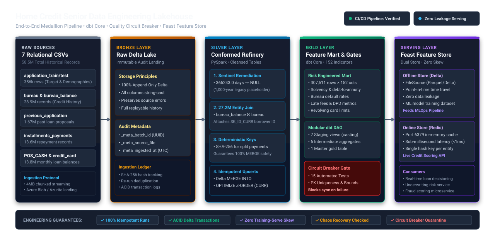
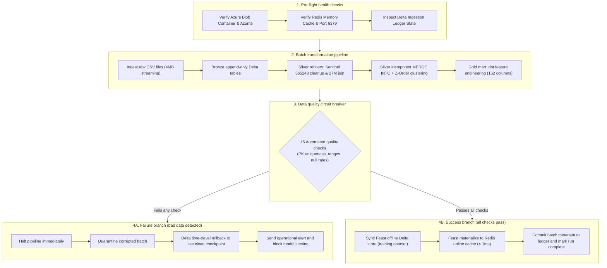

# Home Credit Data Engineering Lakehouse

This repository builds an end-to-end data pipeline for processing bank loan applications and borrower histories. It cleans messy raw data, builds credit risk features, runs automated quality checks, and serves the results to machine learning models.

---

## What this project is about

When people apply for a loan, a bank needs to evaluate their credit history before making a lending decision. That evaluation depends on several sources of information:

1. The current loan application (income, family size, requested loan amount).
2. Credit bureau reports showing loans the person took at other institutions.
3. Historical loan applications made at Home Credit in the past.
4. Monthly repayment logs showing whether past payments arrived on time or late.
5. Monthly balance statements for credit cards and point-of-sale loans.

In the real world, this data arrives in large batches from different branch systems. It contains missing values, placeholder numbers used by older software, duplicate payment entries, and out-of-order records.

This project creates a reliable data factory. It takes raw files, cleans the errors, calculates 152 financial indicators for each customer, verifies data quality with automated circuit breakers, and loads the features into a fast memory cache so credit scoring models can evaluate applications in less than one millisecond.

---

## Architecture and data flow

### 1. Data architecture diagram (Medallion storage layers)

The diagram below shows how raw banking records move through the storage tiers from initial CSV landing to high-speed feature serving.



### 2. Pipeline orchestration and failure recovery workflow

The flowchart below shows how the master pipeline runs each day, checks system health, evaluates the data quality circuit breaker, and protects production models from corrupt data.



---

## The three data layers (Medallion architecture)

The data flows through three progressive stages, often called Bronze, Silver, and Gold.

### 1. Bronze layer (raw storage)
Raw CSV files arrive in an Azure storage container. The pipeline writes these directly into Delta Lake format on disk. No rows are modified or cleaned here. Keeping the raw data untouched gives the bank a permanent audit trail, allowing anyone to verify what the original files looked like when they arrived.

### 2. Silver layer (cleaned and conformed)
The raw data is parsed and corrected:
- **Fixing placeholder values:** Older banking systems used the number `365243` to represent missing dates (representing 1,000 years in days). The pipeline finds these placeholders and replaces them with standard empty values (NULL).
- **Resolving orphan records:** The credit bureau balance table contains 27 million monthly records, but lists only an external credit ID, not the customer ID. The pipeline joins this table with the bureau registry to connect each record to the correct borrower.
- **Handling split payments:** In loan installment records, borrowers sometimes make partial payments on different days for the same bill. To prevent duplicate errors during updates, the pipeline generates a unique digital fingerprint for each payment transaction.
- **Deduplication and updates:** The pipeline runs an atomic merge operation. If a record already exists, it updates it; if it is new, it inserts it.

### 3. Gold layer (business features)
The pipeline calculates 152 summary metrics for each borrower. These include:
- Debt-to-income and loan-to-annuity ratios.
- Past loan approval and refusal rates.
- Percentage of installments paid past the due date.
- Total accumulated late payment fees.
- Credit card revolving balance utilization.

These calculations produce a single table with one row per customer, ready for machine learning models and credit analysts.

---

## Tools used in this project

- **PySpark:** A distributed data processing framework. It handles tables containing millions of rows by dividing computation across multiple processor threads.
- **Delta Lake:** An open-source storage format built on Parquet. It adds ACID transaction support, which means a write operation either finishes completely or rolls back, preventing partially written files from corrupting the dataset.
- **dbt (data build tool):** A tool that organizes SQL transformations into modular, testable steps with dependency graphs and documentation.
- **Feast:** An open-source feature store. It ensures that the exact same feature definitions used during model training are used during live scoring, preventing training-serving skew.
- **Redis:** An in-memory data store. It acts as the online serving cache, returning a customer's entire feature vector in under one millisecond.
- **Azurite & Docker:** Lightweight local containers that simulate Microsoft Azure cloud storage and Redis without requiring cloud credentials or incurring hosting costs during development.
- **Pytest & Ruff:** Quality tools for running automated unit tests and enforcing clean Python code standards.

---

## How local tools map to the production cloud

This repository was designed so that local code can run in production on Microsoft Azure and Databricks by changing connection settings rather than rewriting application logic.

| Local Component | Cloud Service | Purpose in Production |
| :--- | :--- | :--- |
| Azurite Docker container | Azure Data Lake Storage Gen2 (ADLS) | Cloud object storage with enterprise access control and scalable storage for petabytes of data. |
| Local PySpark session | Azure Databricks cluster | A cluster of virtual machines that automatically scales up or down based on data volume. |
| Local Delta folder | Databricks Unity Catalog | Centralized data catalog providing data governance, audit logging, and access control. |
| Local dbt CLI | dbt Cloud with Databricks SQL | Automated execution of transformation models connected directly to cloud data warehouses. |
| Local Circuit Breaker script | Databricks Lakehouse Monitoring | Automated tracking of data quality, column distributions, and metric drift over time. |
| Redis Docker container | Azure Cache for Redis | Managed in-memory database with high availability and replication across availability zones. |
| Local Python orchestrator | Databricks Workflows | Cloud job scheduler that triggers pipeline runs on a calendar schedule or when new files land in storage. |

---

## How the system handles failures

Data pipelines running in production experience network drops, server restarts, and malformed files. This repository includes defensive checks to handle these scenarios safely.

### 1. Interrupted uploads and network drops
Large files are uploaded in 4 megabyte blocks. Azure storage only commits the file once every block is received and an explicit commit signal is sent. If a network connection drops halfway through a 500 megabyte file, the uncommitted pieces are discarded. The pipeline never leaves a half-written file visible in storage.

### 2. Duplicate detection (Idempotency)
Every incoming file has its SHA-256 cryptographic hash calculated before upload. If an engineer or scheduler runs the same monthly batch twice, the uploader checks storage, sees that the file already exists with the exact same fingerprint, and skips the upload. Similarly, the Bronze ingestion ledger records which batches have been processed, preventing duplicate inserts.

### 3. Automated quality circuit breaker
Before features are pushed to Redis or handed over to machine learning models, an automated quality gate inspects the Gold dataset against 15 rules:
- Customer IDs must be 100% unique, with zero duplicates.
- No `365243` placeholder values may leak into the final features.
- Loan amounts and income figures must be strictly positive numbers.
- Credit score indicators must fall within valid normalized intervals between 0 and 1.
- Every column required by the feature store schema must be present and correctly typed.

If any check fails, the pipeline raises an error, halts immediately, and writes an audit report to disk. This prevents bad data from ever reaching customer-facing credit decision systems.

---

## Interactive architecture diagram

An interactive diagram of the entire pipeline, data lineage, and code structure is included in this repository.

To view it, open the file in any web browser:
```bash
# Windows
start docs/architecture_diagram.html

# macOS
open docs/architecture_diagram.html

# Linux
xdg-open docs/architecture_diagram.html
```

The diagram lets you click on each pipeline stage to inspect the underlying source files, verify timing benchmarks, and switch between pipeline flows, relational lineage, and cloud service mappings.

---

## Getting started

### Prerequisites
- Python 3.11
- Docker Desktop (for Azurite and Redis)
- Git

### 1. Start the local infrastructure
Start the local Azurite blob storage and Redis containers:
```bash
docker compose -f docker/docker-compose.yml up -d
```

### 2. Install dependencies
Install the package in editable mode with development tools:
```bash
pip install -e ".[dev]"
```

### 3. Run the automated test suite
Verify code quality, data contracts, and failure recovery:
```bash
pytest tests -v
ruff check src tests
```

### 4. Run the end-to-end lakehouse pipeline
Execute the full 6-stage pipeline for a monthly batch:
```bash
python src/home_credit_de/orchestrator.py --batch batch_3_2025_12
```

This single command uploads the batch to Azurite, appends it to Bronze Delta tables, runs the Silver cleaning and merge operations, computes the 152 Gold features, validates the dataset with the circuit breaker, and syncs customer records into the Redis online store.
